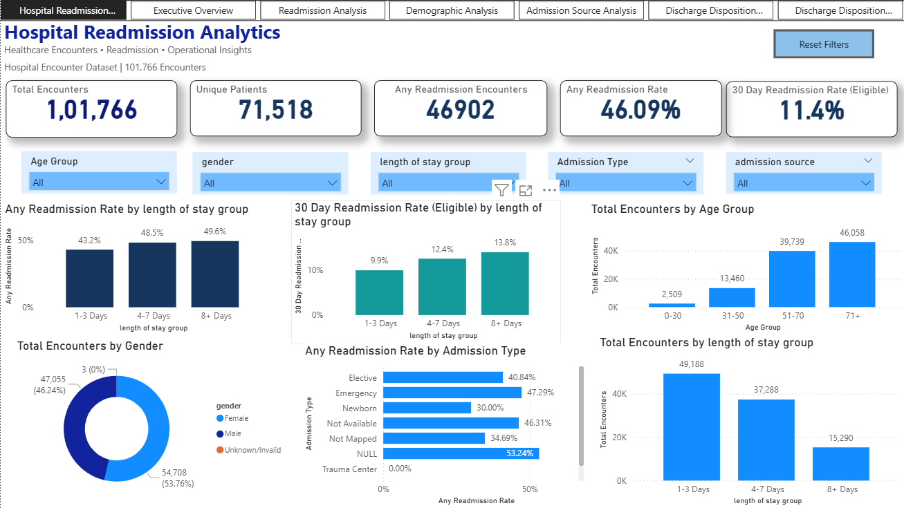

# Hospital Readmission Analytics Dashboard | Power BI

## Project Overview

This project analyzes hospital encounter data using Microsoft Power BI to explore readmission patterns, patient demographics, length of hospital stay, admission sources, and discharge dispositions.

The goal was to transform raw healthcare data into an interactive dashboard that makes key performance indicators and encounter-level patterns easier to explore and understand.

## Dashboard Preview



## Business Objective

Hospital readmissions are an important area of healthcare analytics. Understanding encounter volumes and readmission patterns can help healthcare organizations explore patient and operational trends.

This project focuses on:

- Analyzing overall hospital encounter volumes and readmission patterns.
- Comparing readmission rates across admission types and admission sources.
- Exploring demographic patterns by age group and gender.
- Examining encounter volumes and readmission rates across length-of-stay groups.
- Analyzing discharge disposition patterns.
- Comparing overall readmission rates with eligible 30-day readmission rates.

## Dashboard Pages

The Power BI report contains seven interactive pages:

1. **Hospital Readmission Dashboard** – Provides an overall view of hospital encounters and key performance indicators, with interactive filters and charts covering age groups, gender, admission type, and length-of-stay groups. It includes encounter volumes, overall readmission rates, and eligible 30-day readmission rates.

2. **Executive Overview** – Presents the main KPIs and high-level summaries of encounter volumes and readmissions.

3. **Readmission Analysis** – Examines readmission patterns across admission types.

4. **Demographic Analysis** – Explores encounter volumes and readmission rates by age group and gender.

5. **Admission Source Analysis** – Analyzes hospital encounters and readmission rates by admission source.

6. **Discharge Disposition Analysis** – Examines encounter volumes and readmission patterns across discharge dispositions.

7. **Discharge Disposition Summary** – Provides a tabular summary of encounter volumes and readmission measures by discharge disposition.

## Key Performance Indicators

The following figures represent the overall dashboard totals with the report slicers cleared.

| KPI | Value |
|---|---:|
| Total Encounters | 101,766 |
| Unique Patients | 71,518 |
| Any Readmission Encounters | 46,902 |
| Not Readmitted Encounters | 54,864 |
| Any Readmission Rate | 46.1% |
| Eligible Encounters | 99,343 |
| Eligible 30-Day Readmissions | 11,314 |
| 30-Day Readmission Rate (Eligible) | 11.4% |

### Understanding the Readmission Measures

**Any Readmission Rate**

Measures the percentage of encounters with a recorded readmission, including both readmissions within 30 days (`<30`) and readmissions after 30 days (`>30`).

**30-Day Readmission Rate (Eligible)**

Measures the percentage of eligible encounters with a recorded readmission within 30 days (`<30`).

These measures have different definitions and denominators and should be interpreted separately.

**Important note:** Any Readmission Rate includes all encounters. The 30-Day Readmission Rate (Eligible) excludes encounters classified as ineligible based on discharge disposition.

## Business Insights

The analysis of hospital encounter data revealed the following observations:

1. **Age Group:** The 70–80 age group recorded the highest encounter volume, with 26,068 encounters.

2. **Gender:** Female encounters had a higher Any Readmission Rate (46.92%) compared with male encounters (45.12%).

3. **Admission Type:** Emergency admissions had the highest Any Readmission Rate among the named admission types, at 47.29%.

4. **Length of Stay:** The 1–3 day stay group recorded the highest encounter volume, with 49,188 encounters. However, the 8+ day stay group had the highest eligible 30-day readmission rate, at 13.8%.

5. **Admission Source:** Emergency Room admissions had the highest Any Readmission Rate among the named admission sources, at 49.37%.

6. **Discharge Disposition:** Encounters involving discharge or transfer to a psychiatric hospital or psychiatric unit had an eligible 30-day readmission rate of 36.7%, based on 139 eligible encounters.

### Data Quality Observation

The analysis also identified Null admission-type values and Not Mapped admission-source categories. These categories were kept separate from named categories when interpreting the highest readmission rates.

Their presence highlights the importance of reviewing missing and unmapped values during data preparation.

These findings describe patterns within the available dataset. They do not establish causal relationships or indicate that a particular demographic group, admission type, or discharge category causes readmissions. Rates should also be interpreted alongside their underlying encounter volumes.

## Data Preparation and Transformation

Data preparation and transformation were performed using Power Query and Power BI.

Key activities included:

- Reviewing the source data and identifying data quality considerations.
- Cleaning and preparing columns for analysis.
- Using mapping tables to create readable admission source, admission type, and discharge disposition categories.
- Creating age categories and length-of-stay groups.
- Classifying encounters as eligible or ineligible for the eligible 30-day readmission analysis.
- Creating calculated columns and DAX measures for key performance indicators.
- Organizing the data model and measures to support interactive reporting.

## Tools and Technologies

- **Microsoft Power BI Desktop** – Dashboard development and data visualization.
- **Power Query** – Data cleaning and transformation.
- **DAX** – Calculated columns and measures.
- **CSV files** – Source data and mapping information.
- **GitHub** – Project version control and portfolio presentation.

## Interactive Features

- Gender and Age Group slicers are available on the main dashboard page.
- Slicer selections are synchronized across the report pages.
- Charts and tables respond dynamically to filter selections.
- KPI cards and visual summaries update based on selected categories and filters.

## Data Interpretation and Reporting Considerations

- Encounters with no recorded readmissions are displayed with zero for the relevant overall readmission count and rate.
- The eligible 30-day readmission rate remains blank when there are no eligible encounters in a selected category, because a rate cannot be calculated with a zero denominator.
- Readmission rates are descriptive measures and should be interpreted according to their definitions and denominators.

## Limitations

- The analysis is based on the available hospital encounter dataset and its recorded variables.
- Results describe patterns in the data and do not establish causal relationships.
- Missing and unmapped categories may affect the interpretation of certain results.
- The dashboard is intended for learning, portfolio demonstration, and exploratory analysis.
- It is not a clinical decision-support tool and should not be used to make patient-care decisions.

## Future Improvements

Potential enhancements include:

- Adding more detailed time-based analysis if suitable date information is available.
- Exploring additional patient and encounter characteristics.
- Incorporating further data quality checks and validation.
- Extending the analysis with SQL or Python.

## Repository Structure

The repository is organized to make the project files easy to locate.

```text
hospital-readmission-powerbi/
│
├── README.md
├── Hospital_Readmission_Analytics_Dashboard.pbix
│
├── 01_Raw_Data/
│   ├── diabetic_data.csv
│   └── IDS_mapping.csv
│
└── 02_Screenshots/
    ├── 01_Hospital_Readmission_Dashboard.png
    ├── 02_Executive_Overview.png
    ├── 03_Readmission_Analysis.png
    ├── 04_Demographic_Analysis.png
    ├── 05_Admission_Source_Analysis.png
    ├── 06_Discharge_Disposition_Analysis.png
    └── 07_Discharge_Disposition_Summary.png
```

*Note: Adjust the folder and file names above to match the actual names in your GitHub repository. Check redistribution permissions before uploading source data.*

## How to Explore the Dashboard

1. Clone or download this repository.
2. Open `Hospital_Readmission_Analytics_Dashboard.pbix` using Power BI Desktop.
3. Navigate through the seven report pages.
4. Use the Gender and Age Group slicers on the main dashboard page to explore different segments.
5. Select charts and categories to explore the interactive report.

## Author

**Nikhila Chandupatla**

Aspiring Data Analyst | Healthcare Analytics | Power BI | SQL | SAS | Python

[GitHub Profile](https://github.com/nikhilachandupatla-ctrl)
